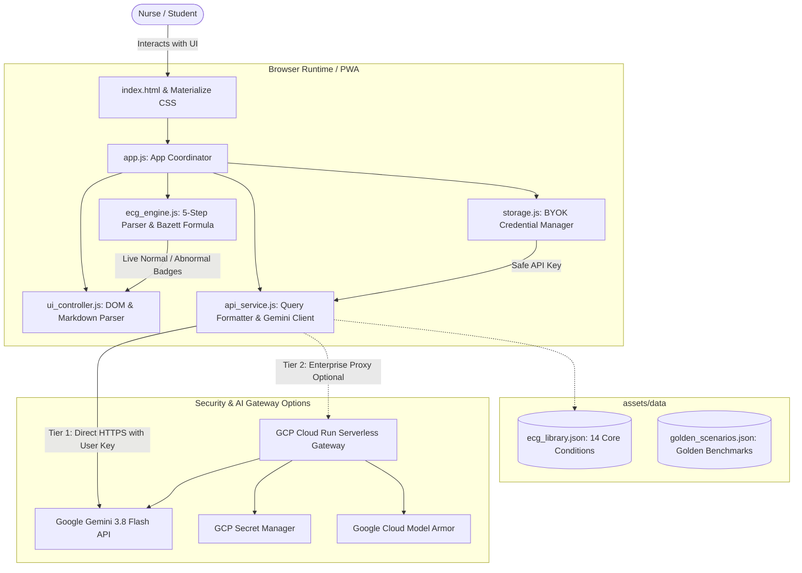
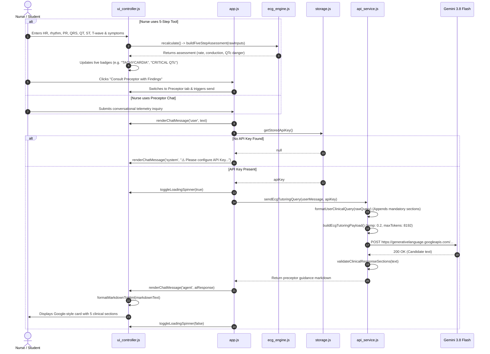

# ECG Instructor AI Agent

> **An interactive, mobile-first clinical preceptor designed to teach nurses how to systematically interpret electrocardiograms (ECGs/EKGs), assess hemodynamic impact, anticipate medical treatments, and internalize bedside stabilization priorities.**  
> *Developed by Jeff Ureta, PHRN, UKRN, USRN.*

[](https://developer.mozilla.org/en-US/docs/Web/JavaScript)
[](https://materializecss.com/)
[](https://ai.google.dev/)
[](https://pages.github.com/)
[](file:///Users/jeffureta/repos/ecg-instructor-agent/tests)
[](file:///Users/jeffureta/repos/ecg-instructor-agent/manifest.json)

---

## 📖 Table of Contents
1. [Core Purpose & Educational Philosophy](#-core-purpose--educational-philosophy)
2. [Clinical Foundations](#-clinical-foundations)
   - [The "Rate" vs. "Shape" Failure Modes](#the-rate-vs-shape-failure-modes)
   - [The 5 Systematic Steps to Read Any ECG](#the-5-systematic-steps-to-read-any-ecg)
3. [Preceptor Output Standard & Safety Guardrails](#-preceptor-output-standard--safety-guardrails)
   - [Mandatory "101" Response Format](#mandatory-101-response-format)
   - [Off-Topic Deflection Protocol](#off-topic-deflection-protocol)
4. [System Architecture](#-system-architecture)
   - [Component Diagram](#component-diagram)
   - [Directory Structure](#directory-structure)
   - [Module Responsibilities & Separation of Concerns](#module-responsibilities--separation-of-concerns)
5. [End-to-End Engineering Flow: Delivering an Answer](#-end-to-end-engineering-flow-delivering-an-answer)
   - [Sequence Diagram](#sequence-diagram)
   - [Execution Lifecycle Steps](#execution-lifecycle-steps)
6. [Clinical Reference Data & Golden Scenarios](#-clinical-reference-data--golden-scenarios)
7. [Security & Two-Tier API Key Safeguards](#-security--two-tier-api-key-safeguards)
8. [Testing & Quality Assurance](#-testing--quality-assurance)
9. [Local Development & Deployment Playbook](#-local-development--deployment-playbook)
   - [Running Locally](#running-locally)
   - [Deploying to GitHub Pages](#deploying-to-github-pages)
   - [Deploying Optional GCP Enterprise Proxy](#deploying-optional-gcp-enterprise-proxy)

---

## 🩺 Core Purpose & Educational Philosophy

### 1. The Core Purpose & Mission
In acute and critical care units (Emergency Department, Intensive Care Unit, Telemetry, and Step-Down), nurses are the first line of surveillance. An electrical arrhythmia is never an abstract academic curiosity—it is an immediate threat to end-organ perfusion.

The **ECG Instructor AI Agent** serves as a mobile-first, 24/7 clinical preceptor that trains staff nurses, nursing students, and ICU/ED trainees during study time to:
- Move from guessing rhythms to using a structured, reproducible **5-step analytical routine**.
- Immediately correlate electrical waveforms with **hemodynamic consequences** ($Cardiac\ Output = Heart\ Rate \times Stroke\ Volume$).
- Anticipate ACLS interventions, rate/rhythm pharmacotherapy, and cath lab activation.
- Master proactive bedside stabilization tasks before physician orders are signed.

### 2. Bedside Stabilization Over Academic Trivia
Traditional cardiology curricula often overwhelm learners with obscure electrophysiology theory. In contrast, this agent enforces the **"Stabilize First" Nursing Doctrine**:

1. **Anticipating Deterioration:** Identifying subtle harbingers of sudden arrest (e.g., Mobitz II progressing to Complete Heart Block, or peaked T-waves heralding sine-wave arrest).
2. **Proactive Nursing Action:** If the patient becomes hemodynamically unstable (hypotensive with SBP < 90 or MAP < 65, acute diaphoresis, chest pain, or altered mental status), the nurse immediately executes baseline emergency protocols:
   - Assessing Airway, Breathing, and Perfusion.
   - Attaching combination defibrillator/pacer pads.
   - Securing dual large-bore IV access.
   - Retrieving the crash cart and cycling vitals every 2–3 minutes.
3. **Structured Mental Models:** Replacing fragmented memorization with a clear taxonomy: is this an acute **Rate** problem (timing/conduction) or a **Shape** problem (ischemia/infarction/electrolyte derangement)?

---

## 🫀 Clinical Foundations

### The "Rate" vs. "Shape" Failure Modes

```
                                  ELECTROCARDIOGRAM (ECG)
                                             │
             ┌───────────────────────────────┴───────────────────────────────┐
             ▼                                                               ▼
     "RATE" PROBLEMS                                                 "SHAPE" PROBLEMS
 (Timing, Conduction, Pacing)                                  (Ischemia, Infarct, Electrolytes)
```

#### Category A: "Rate" Problems (Rhythm Strip Findings & Acute Timing)
* **Sinus Tachycardia (101–160 bpm):** Compensatory physiologic reaction to fever, sepsis, hypovolemia, or pain. *Key nursing pearl: Treat the root cause; never administer beta-blockers for compensatory sinus tachycardia.*
* **Atrial Fibrillation (AFib):** Irregularly irregular, absent P-waves. If unstable: synchronized cardioversion (120–200 J). If stable: rate control (IV Diltiazem or Metoprolol), stroke risk reduction (anticoagulation).
* **Atrial Flutter (AFL):** Sawtooth 'F' waves at ~300 bpm, typically 2:1 conduction (~150 bpm ventricular). Rate control, cardioversion, catheter ablation.
* **Paroxysmal Supraventricular Tachycardia (PSVT):** Rapid, regular narrow QRS (150–220 bpm). If unstable: cardioversion. If stable: vagal maneuvers, rapid IV push Adenosine (6 mg then 12 mg with brisk saline flush).
* **Ventricular Tachycardia (VT):** Wide QRS (> 120 ms) at 120–250 bpm. Pulseless: CPR + unsynchronized defibrillation. Unstable with pulse: synchronized cardioversion (100 J). Stable: IV Amiodarone infusion (150 mg over 10 min).
* **Ventricular Fibrillation (VF):** Chaotic rhythm, no cardiac output. Immediate CPR + Defibrillation (120–200 J biphasic), IV Epinephrine 1 mg q3-5min, IV Amiodarone 300 mg.
* **Symptomatic Sinus Bradycardia (< 60 bpm):** Hypotension, dizziness. IV Atropine 1 mg push (repeat to 3 mg max), transcutaneous pacing, Epinephrine/Dopamine infusion.
* **Atrioventricular (AV) Blocks:**
  - *1st Degree:* Fixed PR > 200 ms with 1:1 conduction. Monitor; review AV-nodal blocking drugs.
  - *2nd Degree Mobitz I (Wenckebach):* Progressive PR prolongation until dropped QRS. Usually nodal/benign.
  - *2nd Degree Mobitz II:* Fixed PR interval with sudden dropped QRS complexes. Infranodal disease with extreme danger of complete heart block. Attach pacing pads immediately.
  - *3rd Degree (Complete Heart Block):* Complete AV dissociation. Atria and ventricles beat independently. Immediate transcutaneous pacing, prepare transvenous/permanent pacing.

#### Category B: "Shape" Problems (12-Lead Morphology & Chemistry)
* **ST-Segment Elevation (STEMI):** J-point elevation $\ge 1\text{ mm}$ in limb leads or $\ge 1.5 - 2.5\text{ mm}$ in precordial leads across contiguous leads. Immediate cath lab activation (< 90 min door-to-balloon), Aspirin 325 mg chewable, Heparin, dual antiplatelet therapy.
* **ST-Segment Depression & T-Wave Inversion:** Horizontal or downsloping ST depression $\ge 0.5\text{ mm}$. Subendocardial ischemia or NSTEMI. Antiplatelets, anti-ischemics (Nitroglycerin), serial high-sensitivity troponins.
* **Hyperkalemia (Peaked T-Waves, $K^+ > 5.5\text{ mEq/L}$):** Narrow, tented T-waves. 3-step stabilization: (1) IV Calcium Gluconate (cardiac membrane stabilization), (2) IV Insulin + D50 + inhaled Albuterol (intracellular shift), (3) Furosemide / Lokelma / emergent hemodialysis (elimination).
* **Hypokalemia ($K^+ < 3.5\text{ mEq/L}$):** ST depression, flat/inverted T-waves, prominent U-waves in V2–V3. High risk of refractory ventricular arrhythmias. IV Potassium Chloride replacement (target $> 4.0\text{ mEq/L}$) and IV Magnesium Sulfate.
* **Critical QTc Prolongation ($QTc > 500\text{ ms}$):** Severe danger of polymorphic VT (Torsades de Pointes). Discontinue all QT-prolonging medications (Ondansetron, Haloperidol, Amiodarone), administer IV Magnesium Sulfate 1–2 g.
* **Bundle Branch Blocks (QRS $\ge 120\text{ ms}$):** RBBB (RSR' "rabbit ears" in V1) vs. LBBB (broad notched R-wave in I, aVL, V5–V6; deep QS in V1; new LBBB with chest pain is treated as a STEMI-equivalent).

---

### The 5 Systematic Steps to Read Any ECG

The application structures user inputs and preceptor reasoning around the standardized clinical sequence:

| Step | Parameter | Clinical Normal Benchmarks | Pathological Significance |
| :--- | :--- | :--- | :--- |
| **Step 1** | **Rate** | 60–100 bpm | $< 60$ Bradycardia, $> 100$ Tachycardia. Quick strip formula: $300 \div (\text{large boxes})$ or $(R\text{-waves in 6-sec strip}) \times 10$. |
| **Step 2** | **Rhythm** | Regular R-R spacing | Regular, Regularly Irregular (Mobitz I), or Irregularly Irregular (Atrial Fibrillation). |
| **Step 3** | **P-Waves** | Present, upright in Lead II, 1:1 with QRS | Absent = AFib/junctional; Sawtooth = Flutter; AV dissociation = 3rd Degree Block. |
| **Step 4** | **PR Interval** | 120–200 ms (3–5 small boxes) | $< 120\text{ ms}$ (WPW pre-excitation); $> 200\text{ ms}$ (1st Degree AV block); Variable (Mobitz I / Complete block). |
| **Step 5** | **QRS & Shape** | QRS $< 120\text{ ms}$, ST isoelectric, $QTc < 450/460\text{ ms}$ | Wide $\ge 120\text{ ms}$ = ventricular rhythm or BBB; ST-elevation = STEMI; Peaked T = Hyperkalemia; $QTc \ge 500\text{ ms}$ = Torsades danger. |

---

## 📋 Preceptor Output Standard & Safety Guardrails

### Mandatory "101" Response Format
Every response generated by the AI preceptor follows a strict 5-part structure written in clear, simple American English:

1. **🎯 Provisional ID:** Identifies the primary rhythm and clearly states whether it is a **"Rate"** or **"Shape"** problem.
2. **🔍 Differential:** Lists the top 2–3 differential diagnoses and provides the exact bedside caliper/strip rule to tell them apart (e.g., marching independent P-waves in Complete Heart Block vs. progressive PR delay in Mobitz I).
3. **🫀 Hemodynamic Impact:** Explains the perfusion mechanism in accessible 101 terms ($CO = HR \times SV$, diastolic filling time, loss of atrial kick, or loss of contractile myocardium).
4. **💊 Treatment / No-Cure Management:** Direct contrast of interventions based on patient presentation:
   - *If Unstable (Hypotension, shock, altered mental status):* Immediate cardioversion, transcutaneous pacing, defibrillation, or emergency pressors (Epi/Dopamine).
   - *If Stable:* Pharmacotherapy (Adenosine, Amiodarone, Diltiazem, Metoprolol), electrolyte repletion, or urgent cath lab activation.
   - *Long-Term / No-Cure:* Permanent pacemaker (PPM), EP ablation, or palliative symptom management for non-reversible nodal disease.
5. **🚨 Role of the Nurse:** Bedside stabilization priorities (combo pads, dual large-bore IVs, vitals q2-3m, crash cart retrieval) and critical medication **HOLD** orders (e.g., holding beta-blockers in heart blocks; holding nitroglycerin in right ventricular STEMI).

### Off-Topic Deflection Protocol
The preceptor operates under strict clinical boundaries:
- **Prohibited Inquiries:** General non-cardiac medicine (dermatology, infections, GI), personal health/smartwatch diagnosis, technical coding/programming assistance, or general trivia/creative writing.
- **Deflection Script:** The agent politely deflects off-topic inquiries using this standardized response:
  > *"I am the ECG Clinical Instructor Preceptor, specifically designed to teach nursing students and acute care staff how to interpret electrocardiograms, assess hemodynamic impact, and stabilize cardiac emergencies. I cannot provide general medical advice, diagnose non-cardiac conditions, answer personal health questions, or assist with coding/programming requests. Let's redirect our session back to rhythm interpretation, 12-lead waveforms, or acute bedside nursing stabilization."*

---

## 🏛 System Architecture

The ECG Instructor AI Agent is designed as a **zero-build, mobile-first Web Application** capable of running statically on GitHub Pages with Bring-Your-Own-Key (BYOK) or through an enterprise Google Cloud Run serverless gateway.

### Component Diagram



### Directory Structure

```
ecg-instructor-agent/
├── index.html                           # Root Semantic HTML5 entry document
├── manifest.json                        # PWA installable manifest
├── gemini.md                            # Comprehensive Architecture & Philosophy specification
├── plan.md                              # Implementation roadmap
├── README.md                            # This comprehensive production documentation
├── css/
│   ├── materialize.min.css              # Materialize CSS core library
│   └── style.css                        # Google Web App theme, typography, badges, & chat layout
├── js/
│   ├── app.js                           # Coordinator & event wiring for chat, modal, and analyzer
│   ├── ecg_engine.js                    # Electrophysiology rules, interval checker, & Bazett QTc
│   ├── api_service.js                   # Gemini API communication, query enrichment, & section checks
│   ├── ui_controller.js                 # DOM rendering, Materialize hooks, markdown-to-HTML parser
│   └── storage.js                       # Safe local credential store (sessionStorage / localStorage)
├── assets/
│   ├── data/
│   │   ├── ecg_library.json             # 14 curated Rate & Shape pathologies with LITFL links
│   │   └── golden_scenarios.json        # Benchmark clinical scenarios for automated evaluation
│   └── img/                             # Icons, waveforms, and reference assets
└── tests/
    ├── ecg_engine.test.js               # Unit tests for interval logic, rate classification, and Bazett QTc
    ├── clinical_response_validation.test.js # Unit tests for system instructions, enrichment, and parser
    └── run_clinical_prompt_evaluation.js    # CI/CD evaluation test against golden scenarios
```

### Module Responsibilities & Separation of Concerns

| Module | Primary Responsibility | Key Exported Functions |
| :--- | :--- | :--- |
| [js/ecg_engine.js](file:///Users/jeffureta/repos/ecg-instructor-agent/js/ecg_engine.js) | Pure mathematical, interval, and electrophysiology classification logic. Zero DOM dependencies. | `classifyHeartRate()`, `evaluatePrInterval()`, `classifyQrsWidth()`, `calculateCorrectedQtc()`, `isQtcSeverelyProlonged()`, `buildFiveStepAssessment()` |
| [js/api_service.js](file:///Users/jeffureta/repos/ecg-instructor-agent/js/api_service.js) | Gemini API request orchestration, clinical prompt enrichment, and section verification. | `getSystemInstructions()`, `formatUserClinicalQuery()`, `validateClinicalResponseSections()`, `buildEcgTutoringPayload()`, `sendEcgTutoringQuery()` |
| [js/ui_controller.js](file:///Users/jeffureta/repos/ecg-instructor-agent/js/ui_controller.js) | DOM rendering, Materialize CSS initialization, status badge toggles, and secure Markdown parsing. | `initializeMaterializeComponents()`, `formatMarkdownToHtml()`, `renderChatMessage()`, `toggleLoadingSpinner()`, `updateAnalyzerBadges()` |
| [js/storage.js](file:///Users/jeffureta/repos/ecg-instructor-agent/js/storage.js) | Safe local browser credential handling. Protects keys from accidental exposure. | `saveApiKey()`, `getStoredApiKey()`, `purgeStoredApiKey()` |
| [js/app.js](file:///Users/jeffureta/repos/ecg-instructor-agent/js/app.js) | Top-level application orchestrator. Hooks UI events to engine calculations and API service calls. | `setupSettingsModal()`, `setupChatInterface()`, `setupAnalyzerTab()` |

---

## ⚙️ End-to-End Engineering Flow: Delivering an Answer

The agent features a rigorous pipeline that transforms nurse observations or freeform telemetry questions into an authoritative, structured clinical preceptor guide.

### Sequence Diagram



### Execution Lifecycle Steps

1. **Input Ingestion & Local Parsing:**
   - The user either inputs raw measurements into the **5-Step Tool** or types a freeform question in the **Preceptor Chat**.
   - If using the 5-Step Tool, [js/ecg_engine.js](file:///Users/jeffureta/repos/ecg-instructor-agent/js/ecg_engine.js) instantly validates the measurements and computes the corrected QT ($QTc$) using Bazett's formula:
     $$\text{QTc} = \frac{\text{QT}}{\sqrt{\text{RR (in seconds)}}}$$
   - Live clinical badge pills update color and status (Green = Stable, Amber = Warning, Red = Danger/Prolonged).

2. **Preceptor Query Synthesis & Guardrail Enrichment:**
   - In [js/api_service.js](file:///Users/jeffureta/repos/ecg-instructor-agent/js/api_service.js), `formatUserClinicalQuery()` appends explicit structural constraints to the prompt. This prevents the LLM from collapsing into a brief one-line rhythm identification and enforces comprehensive answers covering hemodynamics and bedside stabilization.

3. **System Prompt & Hyperparameter Injection:**
   - `buildEcgTutoringPayload()` bundles the preceptor persona (`getSystemInstructions()`) with generation hyperparameters:
     - `temperature: 0.2`: Ultra-low temperature ensures strict adherence to ACLS guidelines and factual electrophysiology, eliminating creative hallucinations.
     - `maxOutputTokens: 8192`: A generous token allowance prevents clinical explanations from truncating mid-sentence.

4. **Credential Retrieval & Dispatch:**
   - [js/storage.js](file:///Users/jeffureta/repos/ecg-instructor-agent/js/storage.js) safely provides the Gemini API key from `sessionStorage` or `localStorage`.
   - A direct HTTPS `POST` is dispatched to the Google Gemini endpoint:
     `https://generativelanguage.googleapis.com/v1beta/models/gemini-3.8-flash:generateContent?key=<KEY>`

5. **Response Validation & Rendering:**
   - The response is checked against `MANDATORY_CLINICAL_SECTIONS` (Provisional ID, Differential, Hemodynamic Impact, Treatment, Role of the Nurse).
   - [js/ui_controller.js](file:///Users/jeffureta/repos/ecg-instructor-agent/js/ui_controller.js) converts the markdown output to sanitized, elevated Material Design cards featuring clear headers, bold medical concepts, and actionable nursing priorities.

---

## 📚 Clinical Reference Data & Golden Scenarios

The repository includes curated clinical datasets in `assets/data/`:

### 1. `assets/data/ecg_library.json`
A library of 14 foundational Rate and Shape pathologies linking directly to canonical [Life in the Fast Lane (LITFL)](https://litfl.com/ecg-library/) educational references:
- **Rate Conditions:** Sinus Tachycardia, AFib, Atrial Flutter, PSVT, Ventricular Tachycardia, Ventricular Fibrillation, Symptomatic Bradycardia, Mobitz II, Complete Heart Block.
- **Shape Conditions:** STEMI, Hyperkalemia (Peaked T-Waves), Hypokalemia & Hypomagnesemia, Critical QTc Prolongation, Left Bundle Branch Block (LBBB).

### 2. `assets/data/golden_scenarios.json`
A benchmark evaluation dataset used to validate clinical preceptor accuracy and safety across complex presentations:
- `CASE-001`: Hyperkalemia with tented T-waves and prolonged PR interval.
- `CASE-002`: Unstable monomorphic Ventricular Tachycardia (175 bpm).
- `CASE-003`: Second-Degree AV Block Mobitz Type II (high-grade block).
- `CASE-004`: Critical drug-induced QTc prolongation ($QTc = 520\text{ ms}$).
- `CASE-005`: Acute inferior wall STEMI with RV infarction alert.
- `CASE-006`: Elderly syncope presenting with bradycardic AFib and Left Bundle Branch Block (modified Sgarbossa evaluation for STEMI-equivalent).

---

## 🔒 Security & Two-Tier API Key Safeguards

Static hosting environments like GitHub Pages serve publicly accessible client code. **Never embed, commit, or hardcode API keys into HTML, JS, or Git commits.**

The application implements a **Two-Tier Production Safeguard Architecture**:

```
TIER 1: CLIENT-SIDE BYOK                          TIER 2: GCP ENTERPRISE PROXY
(Individual Study / Open Source)              (Institutional / Hospital Deployment)
           │                                                    │
[Nurse's Mobile Device]                               [GitHub Pages Frontend]
           │                                                    │
  Enters key in Settings                               POST /api/ecg-preceptor
  Stored in sessionStorage                             (No keys stored on client)
           │                                                    │
Direct HTTPS Call to Gemini API                       [GCP Cloud Run Backend]
 (Key never sent to any server)                                 │
                                                      Pulls key from Secret Manager
                                                      Applies Cloud Model Armor
                                                      Strict Origin & CORS Check
                                                                │
                                                      Calls Gemini 3.8 Flash API
```

### Tier 1: Bring-Your-Own-Key (BYOK) for Individual Study
- Configured via the in-app **Settings Modal** (gear icon in the top navigation bar).
- Key input field is masked (`type="password"`).
- Key is saved to `sessionStorage` by default (automatically purged when the browser tab closes) or optionally `localStorage`.
- Includes a one-click **"Purge Stored API Key"** button that immediately wipes credentials.

### Tier 2: Google Cloud Run Serverless Enterprise Proxy
For hospitals, universities, or testing environments where users do not provide personal keys:
- The backend resides in `backend/main.py` deployed to **Google Cloud Run**.
- API keys are injected at container startup via **Google Cloud Secret Manager**.
- Strict **CORS policies** restrict callers exclusively to the authorized GitHub Pages domain (`https://<username>.github.io`).
- Integrated with **Google Cloud Model Armor** to scrub prompts against prompt injection and redact accidental Patient Health Information (PHI/PII).

---

## 🧪 Testing & Quality Assurance

The codebase includes comprehensive unit tests verifying clinical calculations, prompt enrichment, response structures, and API safety.

### Running the Test Suite
Execute the built-in Node.js test runner:

```bash
# Run all unit and clinical validation tests
node --test tests/ecg_engine.test.js tests/clinical_response_validation.test.js
```

### What the Test Suites Verify
1. **ECG Engine Tests (`tests/ecg_engine.test.js` - 34 Tests):**
   - Heart rate boundary classifications (Bradycardia $< 60$, Normal 60–100, Tachycardia $> 100$).
   - PR interval conduction criteria (Shortened $< 120\text{ ms}$, Normal 120–200, Prolonged $> 200\text{ ms}$).
   - QRS complex duration (Narrow $< 120\text{ ms}$, Wide $\ge 120\text{ ms}$).
   - Bazett's corrected QT interval formula and $> 500\text{ ms}$ critical danger trigger.
   - 5-step assessment synthesis object integrity.

2. **Clinical Validation Tests (`tests/clinical_response_validation.test.js` - 37 Tests):**
   - System instruction completeness (presence of all 5 mandatory preceptor sections and educational philosophy).
   - Query enrichment formatter (ensuring user prompts explicitly enforce the 5 sections).
   - Section validation regex (detecting missing clinical sections in truncated or incorrect responses).
   - Safe Markdown-to-HTML parser (rendering headers, lists, bold text, code spans, and normalizing line endings).
   - Deprecation guard (ensuring endpoint targets `gemini-3.8-flash` and NOT deprecated models like `gemini-2.5-flash`).
   - Token allowance verification (enforcing `DEFAULT_MAX_OUTPUT_TOKENS = 8192`).

3. **Golden Scenario Prompt Evaluation (`tests/run_clinical_prompt_evaluation.js`):**
   - Automated evaluation suite testing the agent's output against `assets/data/golden_scenarios.json`.

---

## 🚀 Local Development & Deployment Playbook

### Running Locally
Because the application is built entirely with Vanilla HTML5, Materialize CSS, and ES6+ modules, it requires no compilation or build steps. Simply serve the repository root over HTTP:

```bash
# Clone the repository
git clone https://github.com/jeffureta/ecg-instructor-agent.git
cd ecg-instructor-agent

# Option A: Python 3 built-in HTTP server
python3 -m http.server 8000

# Option B: Node.js npx serve
npx serve .
```

Open your browser and navigate to `http://localhost:8000`. Enter your Gemini API key in the top-right Settings modal to begin interactive sessions.

### Deploying to GitHub Pages
1. Push your repository to GitHub (`main` branch).
2. On GitHub, navigate to **Settings** > **Pages**.
3. Under **Build and deployment**:
   - **Source:** Deploy from a branch
   - **Branch:** `main` / `/ (root)`
4. Click **Save**. The application will be live at `https://<username>.github.io/ecg-instructor-agent/` within minutes.

### Deploying Optional GCP Enterprise Proxy
To deploy the serverless enterprise proxy:

```bash
# 1. Enable Google Cloud Services
gcloud services enable run.googleapis.com secretmanager.com

# 2. Store your Gemini API Key in Secret Manager
echo -n "YOUR_GEMINI_API_KEY" | gcloud secrets create gemini-api-key --data-file=-

# 3. Deploy container to Cloud Run
gcloud run deploy ecg-preceptor-backend \
  --source ./backend \
  --set-secrets="GEMINI_API_KEY=gemini-api-key:latest" \
  --allow-unauthenticated
```

---

## 👤 Author & Clinical Leadership
**Jeff Ureta, PHRN, UKRN, USRN**  
*Emergency, ICU & Critical Care Nurse Leader | Health Informatics & Agentic AI Specialist*

---

## 📄 License & Disclaimer
This project is licensed under the MIT License.  
**Educational Disclaimer:** The ECG Instructor AI Agent is designed strictly for educational and training purposes for nursing staff, students, and healthcare trainees. It does not provide direct medical advice, replace physician diagnosis, or substitute clinical judgment during actual patient care emergencies. Always follow institutional hospital protocols and ACLS guidelines.
